<div align="center">
  
</div>

# UnchainMail

Self-hosted, privacy-focused disposable email. Open the site and instantly get a
temporary inbox — no signup, no login. Copy the address, receive mail in the
browser, read it, and let everything expire automatically.

Runs entirely on Cloudflare: a single Worker serves the UI and API, **Email
Routing + Email Workers** receive real mail for your domain (no third-party
email provider), **D1** stores inboxes and messages, and a **Cron Trigger**
purges expired data.

## Privacy by design

- No analytics, no tracking scripts, no third-party requests.
- No tracking cookies. The browser keeps only an inbox id + access token in
  `localStorage`.
- No IP logging and no user-agent storage anywhere in the code or schema.
- Access tokens are stored only as SHA-256 hashes; the raw token is shown to the
  client once.
- Message HTML is rendered inside a fully sandboxed `<iframe>` with a strict
  Content-Security-Policy, so message content cannot run scripts or phone home.
- Inboxes and all their messages are deleted automatically when they expire.

## Architecture

| Concern | Implementation |
|---|---|
| UI + API | One Worker (`src/index.ts`) using Hono |
| Inbound mail | Cloudflare Email Routing → `email()` handler, parsed with `postal-mime` |
| Storage | D1 (SQLite) — `inboxes` and `messages` tables |
| Expiry | Cron trigger every 5 min deletes expired inboxes (messages cascade) |
| Static assets | Wrangler `assets` binding serving `public/` |

## Prerequisites

- A domain you control, added to your Cloudflare account.
- Node.js 18+ and a Cloudflare account.
- `npm install` to pull dependencies (Wrangler, Hono, postal-mime).

## Quick start (one command)

After `npm install` and `npx wrangler login`, run:

```bash
npm run setup -- yourdomain.com
```

This automates everything: it checks your login, creates the D1 database (or
reuses an existing one) and captures its id, writes that id and your domain into
`wrangler.jsonc`, applies migrations to the remote database, and deploys the
Worker. If you omit the domain it will prompt for one.

The only step it cannot do for you is enabling Email Routing, since that is a
dashboard action. When the script finishes it prints exactly what to click:

1. Your domain → **Email → Email Routing → Enable**.
2. **Routing rules** → set the catch-all action to **Send to a Worker** →
   choose **unchainmail**.

Prefer to do it by hand, or need to understand each piece? The manual steps
below cover the same ground.

## Setup (manual)

### 1. Install and authenticate

```bash
npm install
npx wrangler login
```

### 2. Create the D1 database

```bash
npx wrangler d1 create unchainmail
```

Copy the printed `database_id` into `wrangler.jsonc`, replacing
`REPLACE_WITH_YOUR_DATABASE_ID`.

### 3. Configure your domain and TTL

Edit the `vars` block in `wrangler.jsonc`:

```jsonc
"vars": {
  "EMAIL_DOMAIN": "yourdomain.com",   // the domain mail is received on
  "INBOX_TTL_MINUTES": "60",          // how long an inbox lives
  "MAX_MESSAGES_PER_INBOX": "50",
  "MAX_MESSAGE_BYTES": "262144"
}
```

### 4. Apply migrations

```bash
# local (for `wrangler dev`)
npx wrangler d1 migrations apply unchainmail --local
# remote (production)
npx wrangler d1 migrations apply unchainmail --remote
```

### 5. Deploy

```bash
npx wrangler deploy
```

### 6. Enable Email Routing

In the Cloudflare dashboard for your domain:

1. Go to **Email → Email Routing** and enable it. This adds the required MX and
   SPF records automatically.
2. Under **Email Routing → Routing rules**, set the **catch-all** action to
   **Send to a Worker** and choose the `unchainmail` worker.

That routes every address at your domain (`*@yourdomain.com`) into the Worker,
which accepts mail only for inboxes that currently exist and rejects everything
else.

## Local development

```bash
npx wrangler dev
```

`wrangler dev` serves the UI and API against your local D1. Note that inbound
email cannot be exercised locally — to test mail end to end, deploy and send a
message to a generated address. You can simulate a stored message locally with:

```bash
npx wrangler d1 execute unchainmail --local --command \
  "INSERT INTO messages (id, inbox_id, from_addr, subject, preview, text_body, received_at, size_bytes, seen) \
   VALUES ('testmsg', '<INBOX_ID>', 'sender@example.com', 'Hello', 'Hi there', 'Hi there', 1700000000000, 100, 0)"
```

## API

All inbox-scoped routes require `Authorization: Bearer <token>`, where the token
is the value returned once at creation.

| Method | Path | Description |
|---|---|---|
| `POST` | `/api/inboxes` | Create an inbox. Optional body `{"localPart":"name"}`. Returns `{id, address, token, expiresAt}`. |
| `GET` | `/api/inboxes/:id` | Inbox metadata (address, expiry). |
| `POST` | `/api/inboxes/:id/extend` | Extend lifetime by one TTL window. |
| `DELETE` | `/api/inboxes/:id` | Destroy the inbox and all its mail. |
| `GET` | `/api/inboxes/:id/messages` | List messages (no bodies). |
| `GET` | `/api/inboxes/:id/messages/:mid` | Read one message (marks seen). |
| `DELETE` | `/api/inboxes/:id/messages/:mid` | Delete one message. |
| `GET` | `/api/config` | Public config (domain, TTL). |

### Example

```bash
# create an inbox
curl -X POST https://your-worker.example.workers.dev/api/inboxes
# => {"id":"...","address":"k7m9p2qx@yourdomain.com","token":"...","expiresAt":...}

# list messages
curl https://your-worker.example.workers.dev/api/inboxes/<id>/messages \
  -H "Authorization: Bearer <token>"
```

## Configuration reference

| Var | Default | Meaning |
|---|---|---|
| `EMAIL_DOMAIN` | `example.com` | Domain that receives mail. |
| `INBOX_TTL_MINUTES` | `60` | Inbox lifetime; also the extend window. |
| `MAX_MESSAGES_PER_INBOX` | `50` | Oldest messages trimmed past this. |
| `MAX_MESSAGE_BYTES` | `262144` | Larger inbound mail is rejected. |

The cron schedule lives in `wrangler.jsonc` under `triggers.crons` (default
every 5 minutes).

## Notes & limits

- Cloudflare Email Routing is receive-only; UnchainMail does not send mail.
- D1 row size limits apply, so very large HTML emails may be truncated by the
  `MAX_MESSAGE_BYTES` guard before storage.
- Because access is token-based with no account recovery, clearing browser
  storage means losing access to that inbox — by design.

## License

MIT. Use it, fork it, run your own.
